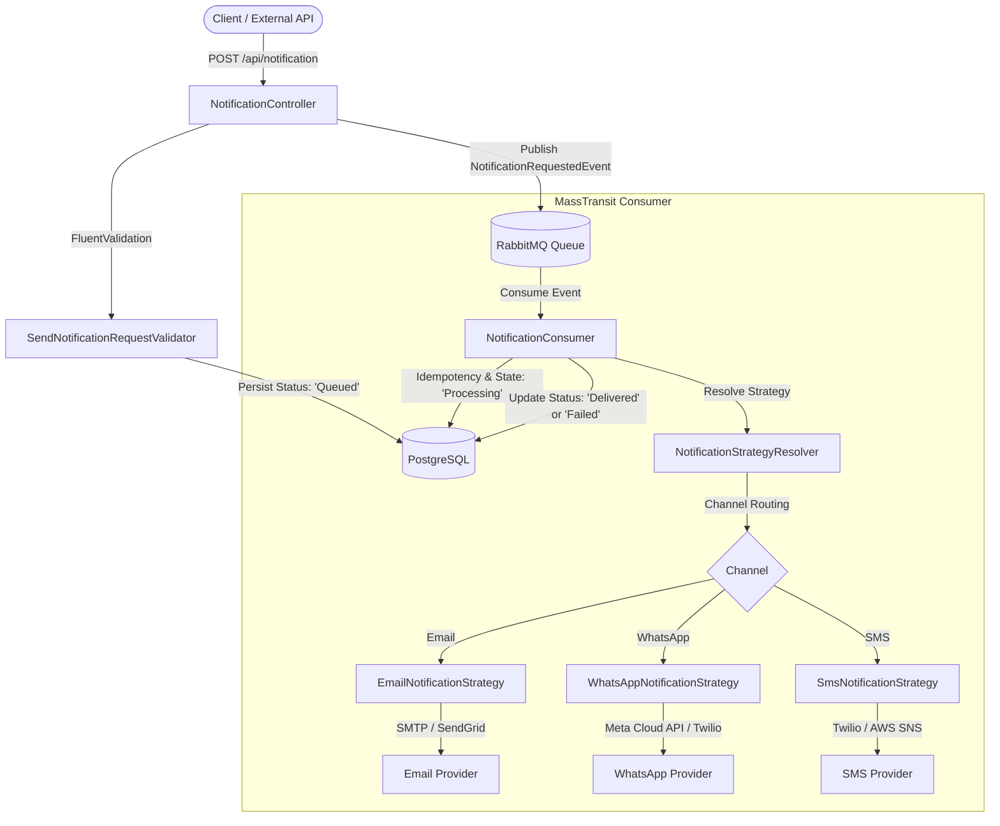

# NotificationSystem 📨⚡

[](https://dotnet.microsoft.com/)
[](https://masstransit.io/)
[](https://www.rabbitmq.com/)
[](https://www.postgresql.org/)
[](LICENSE)

*Read this in [Português](README.pt-BR.md)*

A production-grade, event-driven notification dispatch service built with **.NET 10**, **Clean Architecture**, **MassTransit**, **RabbitMQ**, **PostgreSQL**, and the **Strategy Design Pattern**.

Designed to handle asynchronous multi-channel notification deliveries (such as **Email**, **WhatsApp**, and **SMS**) with built-in resilience, idempotency, retry mechanisms, and delivery lifecycle auditing.

---

## 🏗️ Architecture & Design Patterns

### 1. Strategy Pattern for Multi-Channel Dispatch
The system applies the **Strategy Pattern** to completely decouple channel dispatch logic from ingestion and message consumption:
- `INotificationStrategy`: Strategy interface defining the target channel (`NotificationChannel`) and execution contract `SendAsync`.
- `NotificationStrategyResolver`: Thread-safe, $O(1)$ dependency-injected resolver that dynamically chooses the correct strategy based on message payload.
- Concrete strategies: `EmailNotificationStrategy`, `WhatsAppNotificationStrategy`, and `SmsNotificationStrategy`.



### 2. Clean Architecture Structure
```
NotificationSystem/
├── src/
│   ├── NotificationSystem.Domain/         # Core entities, enums (Channel, Status), domain events
│   ├── NotificationSystem.Application/    # Strategy contracts, Resolver, DTOs, FluentValidators
│   ├── NotificationSystem.Infrastructure/ # Strategy implementations, EF Core DbContext, Repositories, MassTransit Consumer
│   └── NotificationAPI/                   # Presentation layer, Web API controllers, Swagger, DI composition root
├── tests/
│   └── NotificationSystem.UnitTests/      # Automated xUnit tests for Strategy Resolver and validation rules
├── docker-compose.yml                     # RabbitMQ (5672/15672) and PostgreSQL (5432)
└── NotificationSystem.slnx
```

---

## 🚀 Features

- **Multi-Channel Dispatching**: Seamlessly send via `Email`, `WhatsApp`, or `Sms`.
- **Strategy Pattern with $O(1)$ Resolution**: Easily extensible to add new channels (e.g., Push, Slack, Telegram) by implementing `INotificationStrategy`.
- **Asynchronous & Non-Blocking**: Returns `202 Accepted` immediately upon enqueuing.
- **Delivery Lifecycle Auditing**: Tracks every state transition: `Queued` ➔ `Processing` ➔ `Delivered` or `Failed`.
- **Idempotency Safeguard**: Prevents duplicate deliveries on message redelivery or retry.
- **Exponential Retry & DLQ**: Configured MassTransit retry policy (2s, 5s, 10s intervals) with Dead Letter Queue routing on permanent errors.
- **Channel-Aware Validation**: Enforces valid email formats for `Email` and E.164 phone numbers (with country and area codes) for `WhatsApp` and `Sms`.

---

## 🛠️ Getting Started

### Prerequisites
- [.NET 10 SDK](https://dotnet.microsoft.com/download)
- [Docker & Docker Compose](https://www.docker.com/)

### 1. Clone & Start Infrastructure
Start the RabbitMQ and PostgreSQL containers:
```bash
docker compose up -d
```
- **RabbitMQ Management Dashboard**: [http://localhost:15672](http://localhost:15672) (User: `guest` | Pass: `guest`)
- **PostgreSQL**: `localhost:5432` (User: `postgres` | Pass: `password123` | DB: `notificationdb`)

### 2. Run the Application
Navigate to the API folder and run:
```bash
dotnet run --project src/NotificationAPI/NotificationAPI.csproj
```
Access the interactive Swagger UI at: [http://localhost:5238/swagger](http://localhost:5238/swagger)

---

## 🧪 Testing

Execute the automated test suite:
```bash
dotnet test NotificationSystem.slnx
```

---

## 📖 API Usage Examples

### 1. Request an Email Notification
**Endpoint**: `POST /api/notification`
```json
{
  "channel": "Email",
  "recipient": "user@example.com",
  "subject": "Welcome to our platform!",
  "content": "Thank you for signing up. Please confirm your email."
}
```

**Response (202 Accepted)**:
```json
{
  "notificationId": "9b1deb4d-3b7d-4bad-9bdd-2b0d7b3dcb6d",
  "correlationId": "c81d4e2e-bcf2-11e6-869b-7df92533d2db",
  "channel": "Email",
  "recipient": "user@example.com",
  "status": "Queued",
  "subject": "Welcome to our platform!",
  "content": "Thank you for signing up. Please confirm your email.",
  "attempts": 0,
  "errorMessage": null,
  "createdAt": "2026-11-04T14:00:00Z",
  "processedAt": null
}
```

### 2. Request a WhatsApp Notification
**Endpoint**: `POST /api/notification`
```json
{
  "channel": "WhatsApp",
  "recipient": "+5511999998888",
  "content": "Your verification code is 492019."
}
```

### 3. Check Notification Delivery Status
**Endpoint**: `GET /api/notification/{correlationId}`

**Response (200 OK)**:
```json
{
  "notificationId": "9b1deb4d-3b7d-4bad-9bdd-2b0d7b3dcb6d",
  "correlationId": "c81d4e2e-bcf2-11e6-869b-7df92533d2db",
  "channel": "WhatsApp",
  "recipient": "+5511999998888",
  "status": "Delivered",
  "subject": null,
  "content": "Your verification code is 492019.",
  "attempts": 1,
  "errorMessage": null,
  "createdAt": "2026-11-04T14:00:00Z",
  "processedAt": "2026-11-04T14:00:01Z"
}
```

---

## 📄 License
This project is open-source and licensed under the [MIT License](LICENSE).
