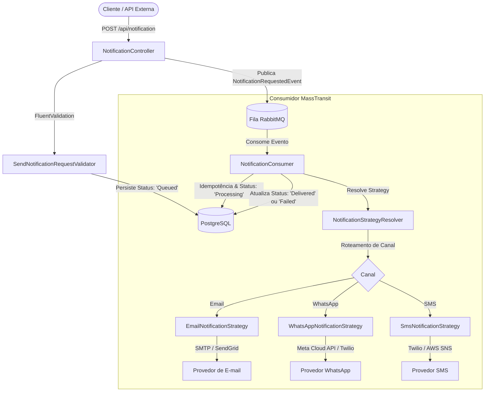

# NotificationSystem 📨⚡

[](https://dotnet.microsoft.com/)
[](https://masstransit.io/)
[](https://www.rabbitmq.com/)
[](https://www.postgresql.org/)
[](LICENSE)

*Leia isto em [English](README.md)*

Um serviço profissional de envio de notificações orientado a eventos construído com **.NET 10**, **Clean Architecture**, **MassTransit**, **RabbitMQ**, **PostgreSQL** e o padrão de projeto **Strategy (Strategy Design Pattern)**.

Projetado para processar envios assíncronos multicanal (como **E-mail**, **WhatsApp** e **SMS**) com resiliência nativa, idempotência, políticas de tentativas (*retry*) e auditoria completa do ciclo de vida das notificações.

---

## 🏗️ Arquitetura & Padrões de Projeto

### 1. Strategy Pattern para Envio Multicanal
O sistema utiliza o padrão **Strategy** para desacoplar completamente as regras de envio específicas de cada canal em relação à API e aos consumidores da fila:
- `INotificationStrategy`: Interface base que define o canal de atuação (`NotificationChannel`) e o contrato `SendAsync`.
- `NotificationStrategyResolver`: Resolvedor registrado no container de Injeção de Dependência que seleciona em tempo constante $O(1)$ a estratégia adequada a partir do payload recebido.
- Estratégias concretas: `EmailNotificationStrategy`, `WhatsAppNotificationStrategy` e `SmsNotificationStrategy`.



### 2. Estrutura em Clean Architecture
```
NotificationSystem/
├── src/
│   ├── NotificationSystem.Domain/         # Entidades centrais, enums (Channel, Status), eventos de domínio
│   ├── NotificationSystem.Application/    # Contratos da Strategy, Resolver, DTOs, validadores FluentValidation
│   ├── NotificationSystem.Infrastructure/ # Implementações das Strategies, DbContext EF Core, Repositórios, Consumidor MassTransit
│   └── NotificationAPI/                   # Camada de apresentação, Controllers Web API, Swagger, inicialização do DI
├── tests/
│   └── NotificationSystem.UnitTests/      # Suíte de testes automatizados xUnit para Strategy Resolver e Validadores
├── docker-compose.yml                     # Containers de RabbitMQ (5672/15672) e PostgreSQL (5432)
└── NotificationSystem.slnx
```

---

## 🚀 Principais Funcionalidades

- **Disparo Multicanal**: Suporte integrado para `Email`, `WhatsApp` e `Sms`.
- **Strategy Pattern com Resolução em $O(1)$**: Fácil de estender para novos canais (ex: Push Notifications, Slack, Telegram) bastando implementar `INotificationStrategy`.
- **Comunicação Assíncrona e Desacoplada**: A API responde imediatamente com status `202 Accepted` ao enfileirar no RabbitMQ.
- **Rastreabilidade e Auditoria de Estados**: Cada notificação passa pelos estados: `Queued` ➔ `Processing` ➔ `Delivered` ou `Failed`.
- **Garantia de Idempotência**: Previne disparos duplicados em caso de reprocessamento de mensagens da fila.
- **Resiliência com Retry Exponencial e DLQ**: Políticas de reenvio do MassTransit (intervalos de 2s, 5s e 10s) e direcionamento automático para fila de erro (*Dead Letter Queue*) em falhas permanentes.
- **Validação Condicional por Canal**: Valida se o formato do e-mail é válido para o canal `Email` e exige formato internacional de telefone E.164 (com DDI e DDD) para `WhatsApp` e `Sms`.

---

## 🛠️ Como Executar

### Pré-requisitos
- [.NET 10 SDK](https://dotnet.microsoft.com/download)
- [Docker e Docker Compose](https://www.docker.com/)

### 1. Subir a Infraestrutura (RabbitMQ & PostgreSQL)
Inicie os containers necessários através do docker-compose:
```bash
docker compose up -d
```
- **Painel do RabbitMQ**: [http://localhost:15672](http://localhost:15672) (Usuário: `guest` | Senha: `guest`)
- **PostgreSQL**: `localhost:5432` (Usuário: `postgres` | Senha: `password123` | Banco: `notificationdb`)

### 2. Executar a Aplicação
Execute o projeto da API:
```bash
dotnet run --project src/NotificationAPI/NotificationAPI.csproj
```
Acesse o painel interativo do Swagger em: [http://localhost:5238/swagger](http://localhost:5238/swagger)

---

## 🧪 Testes Automatizados

Para rodar toda a suíte de testes unitários:
```bash
dotnet test NotificationSystem.slnx
```

---

## 📖 Exemplos de Uso da API

### 1. Solicitar Notificação por E-mail
**Endpoint**: `POST /api/notification`
```json
{
  "channel": "Email",
  "recipient": "usuario@exemplo.com",
  "subject": "Bem-vindo à plataforma!",
  "content": "Obrigado por se cadastrar. Confirme seu e-mail clicando aqui."
}
```

**Resposta (202 Accepted)**:
```json
{
  "notificationId": "9b1deb4d-3b7d-4bad-9bdd-2b0d7b3dcb6d",
  "correlationId": "c81d4e2e-bcf2-11e6-869b-7df92533d2db",
  "channel": "Email",
  "recipient": "usuario@exemplo.com",
  "status": "Queued",
  "subject": "Bem-vindo à plataforma!",
  "content": "Obrigado por se cadastrar. Confirme seu e-mail clicando aqui.",
  "attempts": 0,
  "errorMessage": null,
  "createdAt": "2026-11-04T14:00:00Z",
  "processedAt": null
}
```

### 2. Solicitar Notificação por WhatsApp
**Endpoint**: `POST /api/notification`
```json
{
  "channel": "WhatsApp",
  "recipient": "+5511999998888",
  "content": "Seu código de confirmação é 849201."
}
```

### 3. Consultar Status da Notificação
**Endpoint**: `GET /api/notification/{correlationId}`

**Resposta (200 OK)**:
```json
{
  "notificationId": "9b1deb4d-3b7d-4bad-9bdd-2b0d7b3dcb6d",
  "correlationId": "c81d4e2e-bcf2-11e6-869b-7df92533d2db",
  "channel": "WhatsApp",
  "recipient": "+5511999998888",
  "status": "Delivered",
  "subject": null,
  "content": "Seu código de confirmação é 849201.",
  "attempts": 1,
  "errorMessage": null,
  "createdAt": "2026-11-04T14:00:00Z",
  "processedAt": "2026-11-04T14:00:01Z"
}
```

---

## 📄 Licença
Este projeto é de código aberto e está licenciado sob os termos da licença [MIT](LICENSE).
